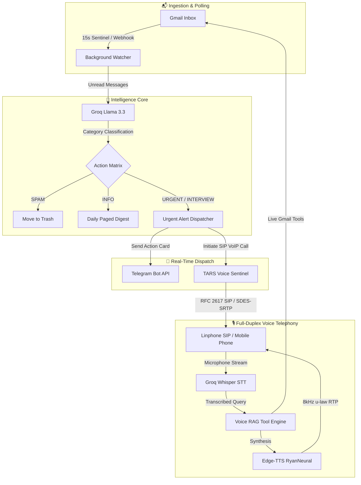

# 🤖 TARS: Tactical Autonomous Reconnaissance Sentinel
### *Autonomous Executive Email & Real-Time Voice Telephony Agent*

<p align="center">
  
  
  
  
  
  
  
</p>

---

## 🌌 Overview

**TARS** is an autonomous executive AI assistant and voice sentinel engineered for **Mohammed Suhail**. Inspired by the personality parameters of TARS (*Interstellar* — Honesty: 90%, Humor: 75%, Loyalty: 100%), it monitors your Gmail inbox 24/7, auto-purges spam, identifies critical opportunities (interviews, recruiter queries, urgent deadlines), and **physically calls your phone over SIP/VoIP** with a young, crisp British AI voice (Marvel's J.A.R.V.I.S. persona).

During a phone call, TARS runs a real-time **Conversational Voice RAG Engine** with live Gmail tool execution: you can ask questions, have TARS search your emails, listen to summaries, approve custom drafted replies, and auto-dispatch your resume—hands-free from your phone dial pad or through spoken dialogue.

---

## ⚡ Key Highlights & Capabilities

### 1. 📞 Full-Duplex VoIP SIP Telephony ($0.00 Forever)
* **Zero Twilio & Zero Paid Telephony:** Communicates directly with Linphone SIP proxies via RFC 2617 MD5 Digest Authentication.
* **Low-Latency Audio Pipeline:** 8 kHz G.711 $\mu$-law streaming with symmetric RTP and dual-mode SDES-SRTP (`AES_CM_128_HMAC_SHA1_80`) encryption via `pylibsrtp`.
* **Jitter Buffer Comfort Silence Streamer:** Continuously transmits digital silence packets during listening turns, maintaining rock-solid network state without signal drops.
* **RFC 2833 DTMF Support:** Tap `1` on your telephone dial pad during a call to confirm email dispatches immediately.

### 2. 🎙️ J.A.R.V.I.S. Voice Persona & Real-Time RAG
* **Crisp British AI Persona:** Uses `en-GB-RyanNeural` (pitch: `-1Hz`, rate: `-2%`) to deliver an unflappable, mid-baritone cadence.
* **Sub-200ms Transcription:** Powered by Groq Whisper for real-time speech-to-text.
* **Zero Dead Silence Fillers:** Pre-cached acoustic fillers (`"Checking that for you now, boss."`) play in under $1\text{ ms}$ while Gmail queries execute.
* **Spoken-Audio Formatting:** Strips markdown, URLs, and asterisks; uses natural contractions (*"I've"*, *"it's"*, *"you're"*) and natural breathing pauses.

### 3. 🧠 Autonomous Gmail Tool Calling
* **Live Tool Invocation:** Equipped with function tools for `search_emails`, `read_email`, `get_recent_unread_emails`, `create_draft_email`, `send_email`, `clean_promotions`, and `trash_emails`.
* **Automatic Resume Dispatcher:** Detects recruiter requests and interview inquiries, automatically attaching [`Mohammed_Suhail_Resume.pdf`](Mohammed_Suhail_Resume.pdf) to verified drafts.
* **Anti-Template Philosophy:** Crafts 100% contextual replies tailored to what each sender requested. Never sends robotic boilerplate.

### 4. 📱 Telegram Mission Control
* **Inline Action Buttons:** Instant mobile controls for `✅ Send Reply & Attach Resume`, `❌ Ignore`, and `🗑️ Move to Trash`.
* **Live In-Chat Draft Previews:** Complete draft formatting rendered directly inside Telegram before sending.
* **Commands:** `/status`, `/scan`, `/clean`, `/summary`.

---

## 🏗️ System Architecture



---

## 📁 Repository Structure

```
├── call_server.py                 # FastAPI & SIP Sentinel daemon server (Ports 8080 & 5060)
├── sip_caller.py                  # Core VoIP telephony engine (RFC 2617, SDES-SRTP, RTP streaming)
├── tars_agent.py                  # TARS autonomous multi-turn reasoning agent & Gmail tools
├── check_emails.py                # 24/7 Gmail watcher, Groq classification & Telegram dispatcher
├── Mohammed_Suhail_Resume.pdf     # Official CV auto-attached to recruiter replies
├── static/
│   ├── index.html                 # Mobile WebRTC/WebSocket browser calling interface
│   └── ...
├── _audio_cache/                  # Pre-compiled u-law acoustic filler assets (0ms latency)
└── requirements.txt               # Production Python dependencies
```

---

## 🚀 Quickstart Guide

### 1. Prerequisites
* Python 3.11 or 3.12+
* Linphone account ([Linphone.org Free SIP](https://www.linphone.org/))
* Google Cloud OAuth 2.0 Credentials (with Gmail API enabled)
* Free [Groq Cloud API Key](https://console.groq.com/)
* Telegram Bot Token ([@BotFather](https://t.me/BotFather))

### 2. Environment Configuration
Create a `.env` file in the project root:

```env
# Google OAuth 2.0
GOOGLE_CLIENT_ID="your_google_client_id"
GOOGLE_CLIENT_SECRET="your_google_client_secret"
GOOGLE_REFRESH_TOKEN="your_google_refresh_token"
USER_EMAIL="mdsuhailtab.1@gmail.com"

# Groq Intelligence (LLM & Whisper STT)
GROQ_API_KEY="gsk_your_groq_api_key"

# Telegram Bot
TELEGRAM_BOT_TOKEN="your_telegram_bot_token"
TELEGRAM_CHAT_ID="your_telegram_chat_id"

# Linphone SIP Credentials
TARS_SIP_USERNAME="suhail_tars"
TARS_SIP_PASSWORD="your_sip_password"
TARS_SIP_DOMAIN="sip.linphone.org"
USER_SIP_URI="sip:mohammed_suhail@sip.linphone.org"

# Voice Persona Tuning (Marvel's J.A.R.V.I.S.)
TARS_VOICE="en-GB-RyanNeural"
```

### 3. Install Dependencies
```powershell
pip install -r requirements.txt
```

### 4. Launch TARS Sentinel Daemon
```powershell
python call_server.py
```

Output confirms inbound registration:
```
🎧 TARS Inbound SIP Server bound on 192.168.1.4:5060
📡 Sent authenticated REGISTER for suhail_tars@sip.linphone.org
✅ TARS is officially registered as sip:suhail_tars@sip.linphone.org!
✅ Linphone Registration Confirmed: 200 OK
```

---

## 📞 Calling TARS

1. **Inbound Inquiries**: Open the **Linphone** app on your phone and dial `suhail_tars`.
2. **Interactive Dialogue**:
   * *“Hello boss, TARS online. How can I help you today?”*
   * *“Did I get any email from Samer?”*
   * TARS plays instantaneous filler audio (*“Checking that for you now, boss.”*), executes `search_emails`, summarizes Samer’s message, and asks if you would like to draft a reply with your resume attached.
   * Speak *"Yes, send it"* or press **`1`** on your keypad to dispatch immediately.

---

## 🔒 Security & Privacy

* **Direct Local Control**: Sensitive SIP audio packets stream directly between your local machine and your phone.
* **Encrypted RTP**: Audio is encrypted via SRTP with SDES key negotiation.
* **Zero Cloud Lock-In**: Operates with $0.00 in cloud telephony bills using free open standards.

---

## 👨‍💻 Author & Credits

**Mohammed Suhail**  
*B.E. Information Technology (Class of 2028), ISL Engineering College, Hyderabad*  
* Founder, **Claude Code & Cowork (C3) Club** ([c3club.vercel.app](https://c3club.vercel.app))  
* GitHub: [@mohammedsuhail0](https://github.com/mohammedsuhail0)  
* LinkedIn: [mohammed-suhail](https://linkedin.com/in/mohammed-suhail-b39883274)
