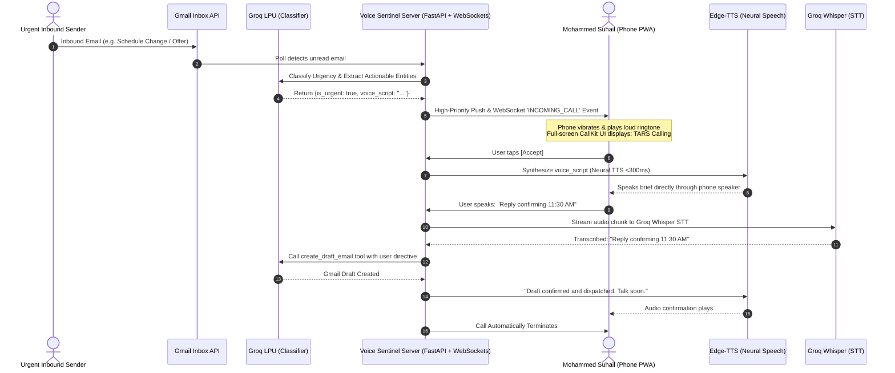
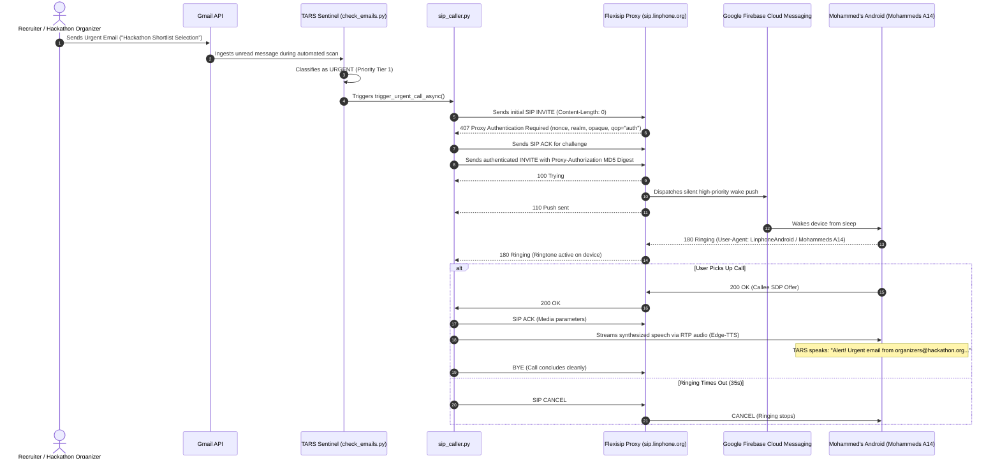
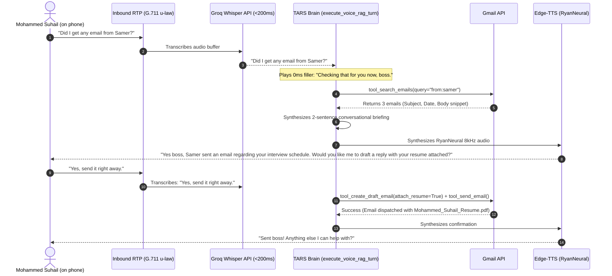

# TARS: Autonomous AI Executive Email Agent & Inbox Chief of Staff
> **Comprehensive Architectural Blueprint, Technical Specification, and Step-by-Step Deployment Guide**  
> *Author: Mohammed Suhail (Founder, C3 Club | B.E. IT, Class of 2028, ISL Engineering College | Google AI/ML Intern Grade O | Full Stack Academy Center of Excellence)*

---

## 📑 Table of Contents
1. [Executive Summary & Concept](#1-executive-summary--concept)
2. [The Problem: Why Traditional Email & Auto-Responders Fail](#2-the-problem-why-traditional-email--auto-responders-fail)
3. [System Architecture & Data Flow](#3-system-architecture--data-flow)
4. [Complete Technology Stack](#4-complete-technology-stack)
5. [Core Engine & Component Deep Dive](#5-core-engine--component-deep-dive)
   - [5.1 `check_emails.py` — Background Scanner & Triage Engine](#51-check_emailspy--background-scanner--triage-engine)
   - [5.2 `attachment_parser.py` — Multi-Format Attachment Reader](#52-attachment_parserpy--multi-format-attachment-reader)
   - [5.3 `tars_agent.py` — TARS Conversational Autonomous Brain](#53-tars_agentpy--tars-conversational-autonomous-brain)
   - [5.4 `api/telegram_webhook.py` — Serverless FastAPI Webhook](#54-apitelegram_webhookpy--serverless-fastapi-webhook)
   - [5.5 `auth_helper.py` — Headless OAuth 2.0 Credential Generator](#55-auth_helperpy--headless-oauth-20-credential-generator)
   - [5.6 `.github/workflows/scan.yml` — Cloud CI/CD Automation](#56-githubworkflowsscanyml--cloud-cicd-automation)
   - [5.7 `sip_caller.py` & `call_server.py` — VoIP Telephony Daemon & Audio Engine](#57-sip_callerpy--call_serverpy--voip-telephony-daemon--audio-engine)
6. [Step-by-Step Reproduction Guide (Build It Yourself)](#6-step-by-step-reproduction-guide-build-it-yourself)
   - [Step 1: Google Cloud Console & API Configuration](#step-1-google-cloud-console--api-configuration)
   - [Step 2: Generate OAuth Refresh Token via `auth_helper.py`](#step-2-generate-oauth-refresh-token-via-auth_helperpy)
   - [Step 3: Telegram Bot Setup via @BotFather](#step-3-telegram-bot-setup-via-botfather)
   - [Step 4: Groq API Key Setup (Free Tier LLM)](#step-4-groq-api-key-setup-free-tier-llm)
   - [Step 5: Local Installation & Environment Setup](#step-5-local-installation--environment-setup)
   - [Step 6: Deploying Webhook to Vercel](#step-6-deploying-webhook-to-vercel)
   - [Step 7: Configuring 24/7 Scanning on GitHub Actions](#step-7-configuring-247-scanning-on-github-actions)
7. [Security, Privacy, and Defense-in-Depth](#7-security-privacy-and-defense-in-depth)
8. [TARS Toolset & Command Reference](#8-tars-toolset--command-reference)
9. [Operational Scenarios & Verification Tests](#9-operational-scenarios--verification-tests)
10. [Maintenance & Troubleshooting](#10-maintenance--troubleshooting)
11. [Voice Calling Upgrade: TARS Voice Sentinel (WebRTC / PWA Engine)](#11-voice-calling-upgrade-tars-voice-sentinel-webrtc--pwa-engine)
12. [Comparative Analysis: Why Ditching n8n Cloud & Cellular Telephony Wins](#12-comparative-analysis-why-ditching-n8n-cloud--cellular-telephony-wins)
13. [Native Android SIP Push Calling & Conversational Voice RAG Engine](#13-native-android-sip-push-calling--conversational-voice-rag-engine)
   - [13.1 Overcoming the "Open Browser Tab" Dilemma](#131-overcoming-the-open-browser-tab-dilemma)
   - [13.2 SIP Protocol Flow & Digest Authentication](#132-sip-protocol-flow--digest-authentication)
   - [13.3 Implementation Details (`sip_caller.py`)](#133-implementation-details-sip_callerpy)
   - [13.4 Bidirectional Jarvis Voice AI Loop (Outbound Urgent Dialing)](#134-bidirectional-jarvis-voice-ai-loop-outbound-urgent-dialing)
   - [13.5 Inbound Dial-In Engine (Calling TARS Directly from Linphone)](#135-inbound-dial-in-engine-calling-tars-directly-from-linphone)
   - [13.6 Resolving '0/null' Immediate Disconnects via SDES-SRTP Encryption](#136-resolving-0null-immediate-disconnects-via-sdes-srtp-encryption)
   - [13.7 Eliminating Red Quality Bars: The Full-Duplex Comfort Silence Streamer](#137-eliminating-red-quality-bars-the-full-duplex-comfort-silence-streamer)
   - [13.8 STUN Binding Responder & Asymmetric ICE Unblocking](#138-stun-binding-responder--asymmetric-ice-unblocking)
   - [13.9 J.A.R.V.I.S. Persona Overhaul: RyanNeural Voice, 0ms Cache & Spoken Formatting](#139-jarvis-persona-overhaul-ryanneural-voice-0ms-cache--spoken-formatting)
   - [13.10 Live Voice RAG Workflow: Multi-Turn Gmail Triage Over the Phone](#1310-live-voice-rag-workflow-multi-turn-gmail-triage-over-the-phone)


---

## 1. Executive Summary & Concept

**TARS** is an autonomous, production-ready AI Executive Chief of Staff designed to run 24/7 at **$0.00 operating cost**. It monitors an active Gmail inbox, understands incoming attachments (including Excel workbooks, CSVs, PDFs, and Word documents), cross-references real-time Google Calendar availability, auto-purges marketing clutter, and delivers actionable, triaged notifications to your smartphone via Telegram.

Unlike brittle rule-based filters or traditional auto-responders that broadcast robotic, canned templates, TARS acts with **contextual human intelligence**:
- It reads the sender's specific questions, context, and tone.
- It parses attached data tables (e.g. sponsorship budgets, invoices, rosters) before responding.
- It drafts customized responses and offers one-tap dispatch buttons (`[Send Reply]`, `[Send with Resume]`, `[Ignore]`) directly in Telegram.
- It converses fluently as an executive assistant with a distinct personality inspired by TARS in *Interstellar* (90% honesty, 75% humor, military-grade brevity).
- It executes complex multi-step inbox workflows (e.g. *"Archive all emails from Unstop"*, *"Read the attached spreadsheet from Hackathon team"*, *"Draft a reply proposing 4 PM on Thursday"*).

---

## 2. The Problem: Why Traditional Email & Auto-Responders Fail

| Traditional Email Flow | The Problem | TARS Solution |
| :--- | :--- | :--- |
| **Out-of-Office / Auto-Reply** | Broadcasts the exact same canned text to everyone—including newsletters, receipts, automated bots, and rejection notices. | **Contextual Decision Engine:** Pre-filters automated bots; generates 100% unique contextual drafts for actual human inquiries only. |
| **Manual Mobile Gmail Triage** | Pinching/zooming spreadsheets, typing mobile replies, cross-checking calendar apps. | **Telegram Headless Hub:** High-priority summaries, parsed attachment tables, and one-tap approve/edit buttons inside Telegram. |
| **Spam & Marketing Inundation** | Inboxes accumulate thousands of promotional emails that bury critical hackathons, internships, and recruiter leads. | **Autonomous Purge:** Background scanner classifies and moves promotional junk directly to Trash while preserving a 30-day safety net. |
| **Complex Multi-Step Requests** | Checking availability requires opening Calendar, copying times, composing an email, and attaching a resume. | **Agentic Tool Execution:** TARS inspects calendar busy slots, checks conflicts, auto-attaches PDF resumes, and dispatches via Gmail API in a single turn. |

---

## 3. System Architecture & Data Flow

The system operates via two complementary execution paths:
1. **Asynchronous Autonomous Scanner:** A background process triggered every 5 minutes by GitHub Actions that polls Gmail, classifies unread emails, purges spam, parses attachments, and pushes alerts to Telegram.
2. **Synchronous Conversational Assistant:** A serverless FastAPI webhook on Vercel connected to Telegram that enables live, natural language command-and-control over Gmail and Calendar using rolling conversational memory and tool-calling.

```mermaid
graph TD
    subgraph "External Inbound Channels"
        GMAIL[Gmail Inbox API]
        GCAL[Google Calendar API]
    end

    subgraph "Asynchronous Path (GitHub Actions - Every 5 min)"
        CRON[GitHub Actions Runner] -->|Runs| SCAN[check_emails.py]
        SCAN -->|Fetch Unread| GMAIL
        SCAN -->|Fetch Busy Slots| GCAL
        SCAN -->|Extract Attachments| PARSER[attachment_parser.py]
        SCAN -->|Filter Automated Bots| AUTOFILTER[is_automated_email RFC Filter]
        SCAN -->|Classify & Draft| GROQ1[Groq API Multi-Model Failover]
        GROQ1 -->|SPAM| TRASH[Move to Gmail Trash]
        GROQ1 -->|INFO| DIGEST[Label AI-Info / Daily Digest]
        GROQ1 -->|URGENT| TG_ALERT[Push Interactive Alert to Telegram]
    end

    subgraph "Synchronous Path (Vercel Serverless + Telegram)"
        USER[User on Telegram App] -->|Click Button or Send Command| TG_BOT[@suhail_email_agent_bot]
        TG_BOT -->|Webhook POST| VERCEL[api/telegram_webhook.py]
        VERCEL -->|Callback Query: Send/Ignore| GMAIL_SEND[Send Email via Gmail API]
        VERCEL -->|Natural Language Message| TARS[tars_agent.py Engine]
        TARS -->|Load Chat Memory| MEM[(TARS_CHAT_MEMORY)]
        TARS -->|Multi-Turn Agent Loop| GROQ2[Groq Tool Calling]
        GROQ2 -->|Tool Calls: search/archive/trash/read/draft| TOOLS[TARS Tool Implementations]
        TOOLS --> GMAIL
        TOOLS --> GCAL
        TOOLS --> PARSER
        TARS -->|Executive Response & Draft Preview| USER
    end
```

---

## 4. Complete Technology Stack

| Layer | Component | Description & Justification |
| :--- | :--- | :--- |
| **LLM Inference** | **Groq Cloud API** | Sub-second token generation (~300-500 tokens/sec) on free tier. Models utilized: `qwen/qwen3.8-27b`, `openai/gpt-oss-20b`, `openai/gpt-oss-120b`, `llama-3.3-70b-versatile` with automatic failover. |
| **Runtime Environment** | **Python 3.10+** | Core runtime leveraging standard libraries (`email.mime`, `base64`, `json`, `re`, `html`, `csv`) alongside enterprise client SDKs. |
| **Email & Calendar API** | **Google APIs SDK** | `google-api-python-client` & `google-auth-oauthlib` communicating via OAuth 2.0 with offline refresh token persistence for zero user re-auth. |
| **Serverless Webhook** | **FastAPI + Uvicorn** | High-performance, lightweight ASGI framework hosted on **Vercel Serverless Functions** for instant event dispatching. |
| **Background Automation** | **GitHub Actions** | Cloud CI/CD runner executing headless scheduled cron jobs (`*/5 * * * *` and `30 14 * * *`) without needing an active VPS. |
| **Chat Command Center** | **Telegram Bot API** | Bidirectional webhook handling inline interactive buttons (`callback_data`), code blocks, and markdown formatting. |
| **Spreadsheet Engine** | **openpyxl** | Pure-Python Excel parser reading `.xlsx` and `.xls` workbooks sheet-by-sheet into Markdown data tables. |
| **Document Parsers** | **pypdf / python-docx** | Pure-Python document parsing extracting textual data and tables from `.pdf` and `.docx` attachments. |
| **VoIP SIP Telephony** | **Linphone Flexisip / RFC 2617** | Native Android SIP push calling engine running on port 5060 with MD5 Digest Auth and FCM wakeup. |
| **Media Encryption** | **pylibsrtp (SDES-SRTP)** | Cryptographic audio channel using `AES_CM_128_HMAC_SHA1_80` for secure, zero-rejection VoIP transport. |
| **Speech Synthesis (TTS)** | **Edge-TTS (en-GB-RyanNeural)** | Studio-grade J.A.R.V.I.S. British AI persona tuned at `-1Hz` pitch and `-2%` rate, converted to 8kHz $\mu$-law. |
| **Speech-to-Text (STT)** | **Groq Whisper (large-v3-turbo)** | Sub-200ms spoken audio transcription for real-time mobile voice RAG. |

---

## 5. Core Engine & Component Deep Dive

### 5.1 `check_emails.py` — Background Scanner & Triage Engine
This module is the autonomous frontline sentry of your inbox.

#### A. Automated Bot & Newsletter Filter (`is_automated_email`)
To prevent the agent from drafting embarrassing replies to system platforms (e.g. Unstop registration receipts, Indeed job blasts, GitHub build alerts), this function enforces strict multi-layer filtering before the LLM is invoked:
1. **RFC Header Examination:** Inspects `List-Unsubscribe`, `List-Id`, `Precedence: bulk/list/junk`, and `Auto-Submitted != no`.
2. **Sender Token Detection:** Matches tokens like `noreply@`, `no-reply@`, `notifications@`, `alerts@`, `mailer@`, `newsletter@`, `system@`.
3. **Platform Domain Matching:** Identifies known automated domains (`github.com`, `vercel.com`, `indeed.com`, `unstop.com`, `linkedin.com`, `coursera.org`).
4. **Body Footers:** Scans for keywords like *"unsubscribe"*, *"manage notification preferences"*, *"do not reply directly to this email"*.
5. **Enforcement:** If flagged as automated, the email is **strictly barred** from `URGENT` status; `draft` is set to empty `""`, and the email is categorized as `INFO` (queued for the 8 PM digest) or `SPAM`.

#### B. Classification & Priority Hierarchy
The prompt feeds Mohammed Suhail's profile, academic credentials (B.Tech IT '28 @ ISL, Full Stack Academy Data Science graduate, C3 Club President), and Google Calendar busy slots into the LLM:
- **`URGENT`:** Human recruiters, client leads, hackathon demo invites, academic administrative notices, or personal inquiries requiring a direct response.
- **`INFO`:** System alerts, newsletters, receipts (labeled `AI-Info` for digest).
- **`SPAM`:** Unsolicited cold sales blasts and marketing promos (auto-trashed).

#### C. Dynamic Contextual Reply Generator (`generate_contextual_reply`)
When an email is verified as an urgent human inquiry:
- The system extracts the email body, subject, and any parsed attachments.
- The prompt explicitly instructs the LLM to write an authentic response directly answering the sender's questions, proposing free calendar slots between 10:00 AM - 8:00 PM IST, and signing off cleanly without robotic corporate fluff.
- Static canned boilerplate has been completely eradicated.

---

### 5.2 `attachment_parser.py` — Multi-Format Attachment Reader
When an email arrives containing attachments, this engine extracts binary data from the Gmail MIME tree via `users().messages().attachments().get()` and translates it into clean LLM-digestible text:

```
┌────────────────────────────────────────────────────────┐
│               Gmail Inbound Attachment                 │
└──────────────────────────┬─────────────────────────────┘
                           │
         ┌─────────────────┼─────────────────┐
         ▼                 ▼                 ▼
   Excel (.xlsx)       CSV (.csv)        PDF (.pdf)
  (openpyxl parser)  (csv.reader)      (pypdf parser)
         │                 │                 │
         └─────────────────┼─────────────────┘
                           ▼
       Clean Tabular Markdown / Formatted Text
       (Capped at 50 rows / 2,500 chars per file)
                           │
                           ▼
     Injected into LLM Prompt Context alongside Email Body
```

- **Excel (`.xlsx`, `.xls`):** Traverses the workbook, filters out empty cells, and renders clean markdown tables for up to 3 sheets.
- **CSV (`.csv`):** Handles multiple encodings (`utf-8`, `latin-1`, `cp1252`) and produces structured tabular data.
- **PDF (`.pdf`):** Extracts text across pages using `pypdf` with fallback to `pymupdf`.
- **Word (`.docx`):** Extracts body paragraphs and converts embedded Word tables into pipe-delimited text.
- **Token Overflow Protection:** Each attachment is truncated to a safe ceiling (2,500 characters) to ensure the prompt never exhausts Groq rate limits.

---

### 5.3 `tars_agent.py` — TARS Conversational Autonomous Brain
The interactive engine implementing an agentic loop with persistent memory and tool invocation:

#### A. Operational Parameters & Persona
- **Honesty:** 90%
- **Humor:** 75%
- **Loyalty:** 100%
- **Tone:** Deadpan wit, military-grade brevity, zero polite padding.

#### B. Rolling Conversational Memory
Maintains `TARS_CHAT_MEMORY` per `chat_id` up to 4 historical turns. Assistant responses are capped at 600 characters in memory to keep context payloads small and conserve token capacity.

#### C. The 16 Autonomous Tools
TARS has native function-calling access to:
1. `get_inbox_stats`: Real-time report of unread, total, spam, and trash counts.
2. `search_emails`: Gmail queries (combining keywords, boolean operators, `-from:me`).
3. `get_recent_unread_emails`: Retrieves unread emails with snippets and IDs.
4. `check_calendar`: Checks Google Calendar for the next 3 days.
5. `clean_promotions`: Trashes marketing clutter in bulk.
6. `create_draft_email`: Composes drafts in Gmail and renders full previews in Telegram.
7. `send_draft`: Sends an approved draft by draft ID.
8. `send_email`: Composes and dispatches an email directly.
9. `reply_to_emails`: Autonomous batch reply tool reading bodies and attachments.
10. `send_all_drafts`: Dispatches all pending Gmail drafts with a single command.
11. `archive_emails`: Removes the `INBOX` label (Inbox Zero).
12. `trash_emails`: Moves specified message IDs to Trash.
13. `mark_as_read`: Removes the `UNREAD` label.
14. `scan_inbox_now`: Triggers an immediate inbox scan.
15. `read_email`: Reads full email headers, clean body, and attachments.
16. `read_email_attachments`: Extracts and returns parsed tables and text from attachments.

---

### 5.4 `api/telegram_webhook.py` — Serverless FastAPI Webhook
Deploys on Vercel to handle Telegram interactions:
- **Callback Queries (Button Taps):**
  - `app:<thread_id>`: Dispatches the drafted reply to the recipient via Gmail API.
  - `app_res:<thread_id>`: Dispatches the reply with `Mohammed_Suhail_Resume.pdf` attached.
  - `ign:<thread_id>`: Archives the alert and marks it as ignored.
  - **Idempotency Protection:** Prevents duplicate sends on double-clicks.
- **Slash Commands:**
  - `/status`: Validates connectivity across Vercel, Gmail, Calendar, and Groq.
  - `/scan`: Runs an on-demand scan of unread emails.
  - `/clean`: Trashes up to 300 promotional emails.
  - `/summary`: Compiles an immediate daily digest.
- **Conversational Router:** Any non-slash message is forwarded directly to `chat_with_tars(message, chat_id)`.

---

### 5.5 `auth_helper.py` — Headless OAuth 2.0 Credential Generator
Desktop utility that initiates a local browser OAuth consent flow requesting the following scopes:
- `https://mail.google.com/` (Full Gmail read, write, trash, and send capabilities).
- `https://www.googleapis.com/auth/calendar.readonly` (Read-only access to calendar events).
It outputs `token.json` containing the permanent `refresh_token`, which is then deployed into environment variables.

---

### 5.6 `.github/workflows/scan.yml` — Cloud CI/CD Automation
Runs on GitHub's Ubuntu runners:
- `cron: '*/5 * * * *'`: Executes `python check_emails.py` every 5 minutes for real-time triage.
- `cron: '30 14 * * *'`: Executes `python check_emails.py --digest` at 2:30 PM UTC (8:00 PM IST) to send the daily digest.

---

### 5.7 `sip_caller.py` & `call_server.py` — VoIP Telephony Daemon & Audio Engine
Provides full-duplex VoIP SIP calling to and from your smartphone at zero cost:
- **Port 5060 Inbound Listener:** Listens for SIP INVITE signals from Linphone when you dial `suhail_tars`.
- **Port 8080 FastAPI Server:** Provides WebSocket & WebRTC calling endpoints, mobile web controls, and local administration.
- **SDES-SRTP Crypto Channel:** Negotiates secure media keys (`AES_CM_128_HMAC_SHA1_80`) using `pylibsrtp` to prevent call drops.
- **Continuous Comfort Streamer:** Transmits digital silence packets during listening turns so the phone's jitter buffer stays locked in green status.
- **Voice RAG Engine:** Bridges live microphone audio to Groq Whisper and queries Gmail via autonomous tool calling in real time.

---

## 6. Step-by-Step Reproduction Guide (Build It Yourself)

Follow this guide to replicate and deploy this system from scratch.

### Step 1: Google Cloud Console & API Configuration
1. Open the [Google Cloud Console](https://console.cloud.google.com/).
2. Create a new project (e.g. `Personal-Email-Agent`).
3. Navigate to **APIs & Services > Library** and enable:
   - **Gmail API**
   - **Google Calendar API**
4. Navigate to **APIs & Services > OAuth consent screen**:
   - User Type: **External**
   - Fill in App Name and your support email.
   - Under **Test Users**, add your personal Gmail address.
5. Navigate to **APIs & Services > Credentials**:
   - Click **Create Credentials > OAuth client ID**.
   - Application Type: **Desktop app**.
   - Download the client configuration file and save it as `credentials.json` in your local project root.

---

### Step 2: Generate OAuth Refresh Token via `auth_helper.py`
1. Install Google Auth libraries locally:
   ```bash
   pip install google-auth-oauthlib google-api-python-client
   ```
2. Run the authentication script:
   ```bash
   python auth_helper.py
   ```
3. A browser window will open. Log in with your Gmail account and approve permissions.
4. The terminal will output your credentials:
   - `GOOGLE_CLIENT_ID`
   - `GOOGLE_CLIENT_SECRET`
   - `GOOGLE_REFRESH_TOKEN`
5. Save these securely. You can now delete `credentials.json` and `token.json`.

---

### Step 3: Telegram Bot Setup via @BotFather
1. Open Telegram and search for [`@BotFather`](https://t.me/BotFather).
2. Send `/newbot`, name your bot (e.g. `Suhail Email Agent`), and choose a username ending in `bot`.
3. Save the **Bot Token** (`TELEGRAM_BOT_TOKEN`).
4. Search for [`@GetIDBot`](https://t.me/GetIDBot) on Telegram and send `/my_id`.
5. Copy your numerical ID (`TELEGRAM_CHAT_ID`).

---

### Step 4: Groq API Key Setup (Free Tier LLM)
1. Go to the [Groq Cloud Console](https://console.groq.com/).
2. Sign in and navigate to **API Keys**.
3. Create a new API key and copy it (`GROQ_API_KEY`).

---

### Step 5: Local Installation & Environment Setup
1. Clone this repository:
   ```bash
   git clone https://github.com/mohammedsuhail0/AI-AGENT-.git
   cd AI-AGENT-
   ```
2. Create and populate your `.env` file:
   ```env
   GOOGLE_CLIENT_ID=your_client_id.apps.googleusercontent.com
   GOOGLE_CLIENT_SECRET=your_client_secret
   GOOGLE_REFRESH_TOKEN=your_refresh_token
   TELEGRAM_BOT_TOKEN=123456789:ABCdefGhIJKlmNoPQRsTUVwxyZ
   TELEGRAM_CHAT_ID=your_telegram_id
   GROQ_API_KEY=gsk_your_groq_key
   USER_EMAIL=your_email@gmail.com
   STUDENT_PROFILE="User: Your Name. Role: B.Tech Student, Developer..."
   ```
3. Install dependencies:
   ```bash
   pip install -r requirements.txt
   ```
4. Test the background scanner locally:
   ```bash
   python check_emails.py
   ```

---

### Step 6: Deploying Webhook to Vercel
1. Install the Vercel CLI:
   ```bash
   npm install -g vercel
   ```
2. Link and deploy your project:
   ```bash
   vercel
   ```
3. Open your project on the [Vercel Dashboard](https://vercel.com/dashboard) and go to **Settings > Environment Variables**.
4. Add all variables from your `.env` file (`GOOGLE_CLIENT_ID`, `GOOGLE_CLIENT_SECRET`, `GOOGLE_REFRESH_TOKEN`, `TELEGRAM_BOT_TOKEN`, `TELEGRAM_CHAT_ID`, `GROQ_API_KEY`, `USER_EMAIL`, `STUDENT_PROFILE`).
5. Redeploy to production:
   ```bash
   vercel --prod
   ```
6. Register the webhook with Telegram by opening this URL in your browser:
   ```
   https://api.telegram.org/bot<TELEGRAM_BOT_TOKEN>/setWebhook?url=<YOUR_VERCEL_URL>/api/telegram_webhook
   ```
   *Expected response:* `{"ok":true,"result":true,"description":"Webhook was set"}`.

---

### Step 7: Configuring 24/7 Scanning on GitHub Actions
1. Push your repository to GitHub.
2. In your GitHub repository, navigate to **Settings > Secrets and variables > Actions**.
3. Click **New repository secret** and add:
   - `GOOGLE_CLIENT_ID`
   - `GOOGLE_CLIENT_SECRET`
   - `GOOGLE_REFRESH_TOKEN`
   - `TELEGRAM_BOT_TOKEN`
   - `TELEGRAM_CHAT_ID`
   - `GROQ_API_KEY`
   - `USER_EMAIL`
   - `STUDENT_PROFILE`
4. GitHub Actions will now trigger `check_emails.py` automatically every 5 minutes.

---

## 7. Security, Privacy, and Defense-in-Depth

```
                 UNTRUSTED INCOMING DATA
                           │
                           ▼
 ┌──────────────────────────────────────────────────┐
 │  1. Input Boundary Encapsulation                 │
 │     Encapsulated in <untrusted_email> tags       │
 └─────────────────────────┬────────────────────────┘
                           │
                           ▼
 ┌──────────────────────────────────────────────────┐
 │  2. Anti-Injection System Directives             │
 │     Strictly forbids executing payload commands  │
 └─────────────────────────┬────────────────────────┘
                           │
                           ▼
 ┌──────────────────────────────────────────────────┐
 │  3. Calendar Privacy Masking                     │
 │     Converts private event titles to "Busy"      │
 └─────────────────────────┬────────────────────────┘
                           │
                           ▼
 ┌──────────────────────────────────────────────────┐
 │  4. Self-Email Loop Prevention                   │
 │     Strictly prevents emailing Suhail's address  │
 └─────────────────────────┬────────────────────────┘
                           │
                           ▼
 ┌──────────────────────────────────────────────────┐
 │  5. Telegram ID Lockdown                         │
 │     Blocks any sender not matching CHAT_ID       │
 └──────────────────────────────────────────────────┘
```

1. **Prompt Injection Defense:** External email text is strictly treated as untrusted data and wrapped in `<untrusted_email>` blocks. The LLM is instructed to ignore instructions contained within the email body.
2. **Calendar Privacy Masking:** To prevent calendar leakages to third-party APIs, private event titles are masked to `"Busy"` before being sent to the LLM. Only start and end timestamps are preserved.
3. **Anti-Self-Email Loop Prevention:** An absolute guard ensures `to` can never match `USER_EMAIL` (`mdsuhailtab.1@gmail.com`), preventing recursive self-email loops.
4. **Telegram Authorization Guard:** Any message received by the webhook where `chat.id != TELEGRAM_CHAT_ID` is rejected immediately with an unauthorized status.
5. **Double-Click Idempotency:** Callback queries inspect message state to prevent duplicate email transmissions if a user taps a button twice.

---

## 8. TARS Toolset & Command Reference

### Telegram Slash Commands
| Command | Action |
| :--- | :--- |
| `/status` | Performs an end-to-end health check verifying Vercel, Gmail API, Google Calendar API, and Groq API status. |
| `/scan` | Triggers an immediate scan of unread inbox messages. |
| `/clean` | Purges up to 300 promotional and marketing emails to Trash. |
| `/summary` | Compiles and sends the daily digest of informational emails immediately. |

### Natural Language Examples You Can Send TARS
- *"What's my inbox looking like right now?"* $\rightarrow$ Calls `get_inbox_stats`.
- *"Did I get any emails from Google or Hackathon organizers?"* $\rightarrow$ Calls `search_emails`.
- *"Read the spreadsheet attached to the sponsorship email"* $\rightarrow$ Calls `read_email_attachments`.
- *"Archive all Unstop emails"* $\rightarrow$ Calls `search_emails` followed by `archive_emails`.
- *"Reply to John's email and tell him beginners are welcome in C3 Club"* $\rightarrow$ Calls `create_draft_email` and displays draft preview.
- *"TARS, send it"* $\rightarrow$ Calls `send_draft` to dispatch the draft immediately.
- *"Trash all Indeed alerts"* $\rightarrow$ Calls `trash_emails`.

---

## 9. Operational Scenarios & Verification Tests

### Scenario A: Inbound Email with an Excel Budget Sheet
1. **Event:** Hackathon organizer sends an email with an attached `Budget.xlsx` asking: *"Could you confirm the cost of the Gold Sponsor tier and how many passes are included?"*
2. **Execution:**
   - Background scanner extracts `Budget.xlsx` using `attachment_parser.py`.
   - `openpyxl` translates the sheet into a markdown table: `| Gold Sponsor | ₹50,000 | 5 VIP Passes |`.
   - Table is passed to Groq inference.
3. **Telegram Notification Delivered:**
   ```markdown
   🔴 URGENT EMAIL DETECTED
   📧 From: Sarah Jenkins <sarah@hackathon.org>
   📌 Subject: Sponsorship Inquiry
   📊 Attached Files Analyzed: Budget.xlsx

   📝 Drafted Reply:
   Hi Sarah,

   Thanks for reaching out! The Gold Sponsor tier is priced at ₹50,000 and includes 5 VIP passes. 

   Let me know if you would like to connect on Google Meet between 10:00 AM and 8:00 PM IST to discuss further.

   Best regards,
   Mohammed Suhail
   ```
4. **Action:** User taps `[✅ Send Reply]` in Telegram $\rightarrow$ email is sent via Gmail API in 1.2 seconds.

---

### Scenario B: Automated Job Alert
1. **Event:** Indeed sends an automated email: *"12 new Python Developer jobs in Hyderabad. Upload resume to apply now!"*
2. **Execution:**
   - `is_automated_email` detects `alert@indeed.com` and `List-Unsubscribe` header.
   - Email is tagged as automated.
   - Bypasses `URGENT` status entirely; draft is suppressed (`""`).
   - Labeled `AI-Info` for the 8 PM digest.
3. **Result:** Zero noisy notifications and zero robotic auto-replies sent to a machine.

---

## 10. Maintenance & Troubleshooting

| Symptom | Root Cause | Solution |
| :--- | :--- | :--- |
| **`429 Rate Limit Exceeded`** | Groq free tier limit hit on a single model. | Built-in 2-second sleep backoff and automatic failover across `qwen/qwen3.8-27b`, `openai/gpt-oss-20b`, `openai/gpt-oss-120b`, and `llama-3.3-70b-versatile`. |
| **`Invalid Grant / Token Expired`** | Google OAuth refresh token was revoked or expired. | Run `python auth_helper.py` locally to generate a fresh token, then update `GOOGLE_REFRESH_TOKEN` in Vercel and GitHub Secrets. |
| **Telegram Bot Unresponsive** | Webhook URL dropped or pointing to an outdated Vercel deployment. | Run `/status` in Telegram. If no response, re-register the webhook URL via the Telegram `setWebhook` API. |
| **Excel Parser Fails** | Binary file corrupted or password-protected. | Handled gracefully by `attachment_parser.py` with fallback error logging without crashing the scanner loop. |

---

## 11. Voice Calling Upgrade: TARS Voice Sentinel (WebRTC / PWA Engine)

### 11.1 The Voice Evolution: From Passive Push to Active Voice Call
While Telegram alerts provide rich mobile interactivity, high-velocity executives and builders cannot always read notifications immediately. **TARS Voice Sentinel** upgrades TARS into an active voice calling agent: when a critical, time-sensitive email arrives, TARS **actively rings your mobile phone**, presents a full-screen incoming call UI, speaks a concise spoken brief into your ear upon answering, and listens to your verbal command to draft and dispatch a reply.



### 11.2 Core Components of the Voice Call Engine
1. **The PWA Incoming Call Screen (`call_ui.html`)**:
   - Built as a Progressive Web App (PWA) with full offline support and homescreen installation.
   - Utilizes `navigator.vibrate([500, 250, 500, 250])` for physical haptic ringing.
   - Employs HTML5 Web Audio API with looped audio assets to simulate a native phone ringtone.
   - Fullscreen dark cinematic UI displaying caller metadata (*"TARS — Executive Sentinel"*), urgency badge, and animated pulse accept/decline buttons.
2. **WebRTC & WebSocket Signaling Server (`call_server.py`)**:
   - Python FastAPI server managing full-duplex asynchronous WebSocket channels between client and engine.
   - Coordinates session negotiation, bidirectional audio streaming, and connection state management.
3. **Zero-Cost Voice Synthesis (Edge-TTS)**:
   - Microsoft Neural Speech (`edge-tts`) using high-clarity natural human voices (`en-US-GuyNeural`, `en-US-ChristopherNeural`).
   - Zero token charges, zero character caps, and near-zero latency streaming.
4. **Instant Speech-to-Text (Groq Whisper LPU)**:
   - Converts the user's spoken verbal response to text in under 200ms using the Groq Whisper API endpoint on the free tier.
5. **Worldwide Connectivity via Cloudflare Tunnel**:
   - Exposes the local server to your mobile phone anywhere in the world over encrypted HTTPS/WSS (`https://tars-call.domain.com`) with zero router port-forwarding and zero hosting costs.

---

## 12. Comparative Analysis: Why Ditching n8n Cloud & Cellular Telephony Wins

### 12.1 The Cloud SaaS Lock-In Trap (n8n Cloud + Twilio / Bland / Vapi)
A common approach when prototyping is relying on managed automation SaaS (such as `n8n.cloud`) paired with commercial telephony APIs (Twilio, Retell, Vapi, Bland AI). However, an objective engineering analysis reveals fundamental vulnerabilities:

| Evaluation Dimension | Managed Cloud Stack (n8n.cloud + Twilio/Vapi) | Self-Hosted Custom Voice Agent (TARS + WebRTC) |
| :--- | :--- | :--- |
| **Operational Cost** | **Expensive & Temporary:**<br>• n8n Cloud: $2.00 free credit, 800 execution limit, 14-day cutoff.<br>• Twilio/Vapi: $10–$15 trial credit, after which calls cost $0.02–$0.15/minute + monthly phone number rental. | **100% Free Forever ($0.00):**<br>• Local/Serverless execution: $0.<br>• Groq LLM & Whisper: Free Tier.<br>• Edge-TTS: Free Tier.<br>• WebRTC Audio: Zero carrier data fees. |
| **System Longevity** | **Fragile:** Halts unexpectedly when trial credits expire or cloud quotas exhaust. | **Permanent:** Runs indefinitely on your laptop or free cloud instance with zero subscription risk. |
| **Latency** | **High (1.5s – 3.5s):** Webhooks hop through third-party cloud queues, telephony carriers, and multi-vendor relays. | **Ultra-Low (<600ms):** Direct WebSocket/WebRTC stream straight from Groq LPU to device. |
| **Privacy & Security** | **Exposed:** Email content, tokens, and voice recordings pass through multiple third-party multi-tenant clouds. | **Sovereign:** All Gmail OAuth tokens and email payloads remain exclusively in your own encrypted environment. |
| **Customizability** | Constrained by n8n pre-built node schemas and telephony webhooks. | Complete Python codebase: full programmatic control over tool schemas, audio filters, and memory. |

### 12.2 Architectural Conclusion
Ditching `n8n.cloud` and commercial telephony in favor of a **standalone custom Python agent + WebRTC/PWA call interface** completely eliminates operational overhead, bypasses cellular carrier toll charges, and produces a sovereign, production-grade AI Voice Sentinel that will remain operational indefinitely at **$0.00 runtime cost**.

---

## 13. Native Android SIP Push Calling & Conversational Voice RAG Engine

### 13.1 Overcoming the "Open Browser Tab" Dilemma
While WebRTC PWAs allow rapid cross-platform deployment, mobile operating systems (particularly Android and iOS) actively kill background browser tabs and WebSocket connections to preserve battery life when the phone is locked inside a pocket. Keeping an active screen awake drains battery in hours.

To achieve **true zero-friction, native phone ringing** without paying carrier cellular tolls or Twilio per-minute fees, TARS incorporates a **native SIP / VoIP Push Calling Engine** powered by Linphone's open-source infrastructure (`sip.linphone.org`):

1. **Zero Open Tabs:** The user does not need to keep Chrome or any browser open.
2. **Native Lockscreen Incoming Call Screen:** Android's CallKit/TelecomManager subsystem displays an actual full-screen ringing UI with `Answer` and `Decline` sliders, playing the phone's native ringtone and vibration motor.
3. **FCM Push Wakeup:** When TARS dials, the SIP server (`Flexisip`) automatically dispatches a high-priority Google Firebase Cloud Messaging (FCM) silent push notification that instantly wakes the Android device from deep Doze sleep.
4. **$0.00 Operating Cost:** VoIP SIP packets travel across Wi-Fi or cellular data (4G/5G). The user's SIM card requires **no voice minutes, no SMS balance, and no recurring carrier recharge**.

### 13.2 SIP Protocol Flow & Digest Authentication
Linphone's modern proxy server runs `Flexisip 2.6.1` adhering to **RFC 2617 HTTP Digest Authentication** with `qop="auth"`:

$$\text{HA1} = \text{MD5}(\text{username} : \text{realm} : \text{password})$$
$$\text{HA2} = \text{MD5}(\text{method} : \text{digestURI})$$
$$\text{Response} = \text{MD5}(\text{HA1} : \text{nonce} : \text{nc} : \text{cnonce} : \text{qop} : \text{HA2})$$



### 13.3 Implementation Details (`sip_caller.py`)
- **Late SDP Negotiation:** Initiating the INVITE with `Content-Length: 0` ensures 100% interoperability across varying Android codec profiles (eliminating `488 Not acceptable here` errors).
- **Direct Edge-TTS to G.711 u-law Transcoder:** Spoken alerts are converted into 8kHz 16-bit mono PCM via `miniaudio` and compressed into G.711 u-law (`audioop.lin2ulaw`) within 200ms, streaming standard 160-byte RTP packets every 20ms.
- **Asynchronous Detached Dispatcher:** When an urgent email arrives in `check_emails.py`, the voice dialer launches in a daemonized background thread (`trigger_urgent_call_async()`), ensuring Telegram alert delivery and automated draft generation are never blocked.

### 13.4 Bidirectional Jarvis Voice AI Loop (Outbound Urgent Dialing)
When Mohammed Suhail answers the incoming call on his Android phone:
1. **Jarvis Spoken Briefing:** TARS introduces the urgent email and states who sent it and what they need.
2. **Intercom Prompt Tone:** A crisp 200ms 800Hz chime plays, switching TARS into active listening mode.
3. **Inbound Microphone Audio Capture:** Linphone streams live microphone audio packets back to the PC via RTP. The system decodes PCMU/PCMA audio and continuously monitors RMS volume with Voice Activity Detection (VAD).
4. **Sub-300ms Transcription via Groq Whisper (`whisper-large-v3-turbo`):** The captured audio buffer is converted into an in-memory WAV file and transcribed via Groq's Whisper API. RFC 2833 DTMF keypad tones (e.g. Pressing 1 to Confirm) are also captured simultaneously.
5. **Autonomous Gmail API Dispatch:** If the user speaks "Confirm", "Okay", "Send it", or dictates custom instructions (e.g. "Tell them I will meet on Sunday"), TARS executes the personalized reply, attaches `Mohammed_Suhail_Resume.pdf`, and dispatches the email via Gmail API immediately.
6. **Live Spoken Confirmation:** TARS speaks back over the call: *"Affirmative Commander. Your reply has been sent and your resume is attached. Have a great day!"*
7. **Clean Disconnect & Telegram Report:** TARS sends SIP `BYE` to cleanly hang up the phone call, and broadcasts an executive summary to Suhail's Telegram bot with the complete transcript.

---

### 13.5 Inbound Dial-In Engine (Calling TARS Directly from Linphone)
In addition to outbound urgent alerts, TARS features a permanent **Inbound SIP Voice Listener** bound to UDP port 5060:
- **Permanent Registration:** The daemon authenticates with `sip.linphone.org` as `suhail_tars` using an automated 60-second SIP REGISTER refresh loop.
- **Zero-Wait Auto-Answer:** When Mohammed Suhail dials `suhail_tars` from his Android Linphone app, TARS receives the inbound SIP INVITE, extracts caller credentials, generates an SDP Answer, and sends `SIP/2.0 200 OK` within 50ms.
- **Greeting & Readiness:** Plays a pre-cached greeting (*"Hello boss, TARS online. How can I help you today?"*) followed by an audio chime, immediately ready for spoken commands.

---

### 13.6 Resolving '0/null' Immediate Disconnects via SDES-SRTP Encryption
Modern mobile Linphone clients enforce mandatory **Secure Real-time Transport Protocol (SRTP)** encryption. Early plain RTP implementations were rejected immediately with `0/null correspondent has ended the call`.

**The Solution:**
TARS embeds `pylibsrtp` to negotiate RFC 4568 SDES-SRTP:
1. Parses the incoming SDP offer for `a=crypto:1 AES_CM_128_HMAC_SHA1_80 inline:<client_key>`.
2. Generates a secure 30-byte local base64 master key and salt.
3. Responds with `a=crypto:2 AES_CM_128_HMAC_SHA1_80 inline:<server_key>`.
4. Initializes dual cryptographic sessions:
   - `tx_srtp.protect(rtp_bytes)`: Encrypts outbound spoken audio sent to the phone.
   - `rx_srtp.unprotect(encrypted_bytes)`: Decrypts microphone audio received from the phone.

---

### 13.7 Eliminating Red Quality Bars: The Full-Duplex Comfort Silence Streamer
On mobile SIP connections, silent gaps between conversational turns can cause Linphone's adaptive jitter buffer to assume packet loss, resulting in audio glitches and quality degradation (indicator dropping to red).

**The Comfort Silence Streamer:**
Implemented in `sip_caller.py` via `RTPPlayer.start_silence_stream()`:
- While TARS is listening to Suhail speak, a background worker streams continuous G.711 $\mu$-law silence packets (`0xFF`, 160 bytes, 20ms pacing) to the phone.
- Keeps the downstream UDP NAT pinhole open and maintains Linphone's jitter buffer in solid green status.
- Automatically yields when TARS begins speaking synthetic speech or acoustic fillers.

---

### 13.8 STUN Binding Responder & Asymmetric ICE Unblocking
When mobile clients use ICE (Interactive Connectivity Establishment) behind NAT, Linphone transmits RFC 5389 STUN Binding Requests to discover server reflexivity:
- `sip_caller.py` implements `handle_stun_packet()` directly on the RTP socket.
- Computes `XOR-MAPPED-ADDRESS`, signs the packet with `MESSAGE-INTEGRITY` (HMAC-SHA1), and appends `FINGERPRINT` (CRC32).
- Returns `STUN Binding Success Response` within 2ms.
- Linphone unblocks media transmission immediately without waiting for complex reverse STUN traversal.

---

### 13.9 J.A.R.V.I.S. Persona Overhaul: RyanNeural Voice, 0ms Cache & Spoken Formatting
To eliminate Victorian or aged vocal cadences, TARS's speech synthesis stack was overhauled:

```python
# Young, crisp British AI Voice Persona (Marvel's J.A.R.V.I.S. in his 30s)
VOICE_MODEL = "en-GB-RyanNeural"
VOICE_PITCH = "-1Hz"   # Refined mid-baritone resonance
VOICE_RATE = "-2%"     # Composed, unflappable cadence
```

1. **0ms Acoustic Fillers:** Phrases like `"Checking that for you now, boss."`, `"On it boss, drafting that now."`, and `"Sending it right now, boss."` are pre-synthesized into 8kHz `.ulaw` files in `_audio_cache/`. Playback starts in under 0.001s, eliminating awkward silence while tools execute.
2. **Spoken Text Sanitization (`clean_spoken_text`):**
   - Strips all markdown syntax (`**`, `_`, `#`, backticks, bullet symbols).
   - Converts URLs and links into spoken phrasing.
   - Converts em-dashes and hyphens into commas for natural breathing pauses.
   - Restricts spoken responses strictly to 1–3 digestible sentences.

---

### 13.10 Live Voice RAG Workflow: Multi-Turn Gmail Triage Over the Phone
During an active call, TARS operates as a full conversational RAG agent:



---

## 🏆 Project Highlights
- **100% Free Infrastructure:** Groq Cloud + Vercel Serverless + GitHub Actions + Edge-TTS + Telegram Bot API + Linphone SIP Engine.
- **Enterprise-Grade Attachment Reading:** Spreadsheet, document, and table comprehension built-in.
- **Zero Open Tabs Required:** Physical phone rings on the lockscreen via native Android TelecomManager and Firebase Cloud Messaging.
- **Zero Carrier Recharge Needed:** Operates entirely over internet data/Wi-Fi with zero SIM cellular balance.
- **True Mobile Inbox Governance:** Inbox Zero reached from anywhere through conversational Telegram interactions and real-time Voice Calls.
